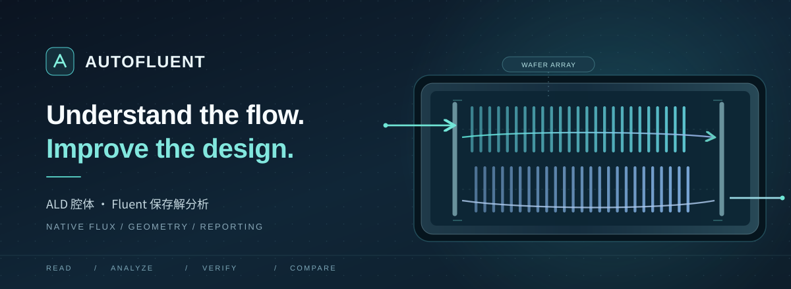

<div align="center">



<br />

### Fluent saved solutions. Clearer flow insight.

面向 ALD 反应腔的 Fluent 保存解分析工作台。  
从原生面通量到晶圆片间、挡板、守恒与方案对比，让数据直接服务下一轮结构优化。

<p>
  <a href="https://github.com/1463503175-pixel/AutoFluent/releases/download/2.0/AutoFluent.exe"><strong>Download latest Windows EXE</strong></a>
  &nbsp;&nbsp;·&nbsp;&nbsp;
  <a href="docs/GETTING_STARTED.md">Quick start</a>
  &nbsp;&nbsp;·&nbsp;&nbsp;
  <a href="worker/">Analysis source</a>
</p>

<sub>Windows x64 &nbsp; / &nbsp; ANSYS Fluent H5 &nbsp; / &nbsp; 最新发布 2.0 · Worker 源码已同步</sub>

</div>

---

## 最新发布与源码同步

| 最新集成程序 | 源码状态 |
|---|---|
| [Release 2.0](https://github.com/1463503175-pixel/AutoFluent/releases/tag/2.0) · 2026-11-22 · [AutoFluent.exe](https://github.com/1463503175-pixel/AutoFluent/releases/download/2.0/AutoFluent.exe) | 已同步原始 EXE 及 56 个内嵌项目文件（50 个 Python 文件、3 个模板、3 个资源）。 |

查看 [拆包结果与源码归属](release_payload/2.0/README.md) · [拆包工作流](https://github.com/1463503175-pixel/AutoFluent/actions/workflows/sync-integrated-release.yml)。[SHA-256 校验清单](SHA256SUMS.txt) 覆盖新版 EXE 与恢复文件。Go 桌面源码、构建定义及原有测试未包含于新版 EXE，保留 V2.10.5 历史基线；不可据此声称能完整重建 Release 2.0。历史 ZIP 继续保留。静态核验不等于真实 Fluent / Windows 实机验收。

## From simulation to insight

AutoFluent 从已有的 `.cas.h5` 与 `.dat.h5` 文件读取 Fluent 原生数据，将**文件核对、几何识别、质量流量积分、结果验证和报告生成**整合为一套桌面工作流。

离线分析直接使用保存解，无需连接 Workbench，也不会重新初始化或迭代计算。对可以确认的结果独立输出；遇到复杂几何时，支持通过模型配置指定搜索范围和截面分区，避免用未经确认的数量替代真实测量。

<div align="center">


</div>

## Built for flow analysis

<table>
<tr>
<td width="50%" valign="top">
<h3>01 / Native H5 analysis</h3>
<p>直接分析 Fluent Case/Data 保存解，核验文件对应关系、面索引与原生 <code>SV_FLUX</code> 数据。分别统计入口、出口的正向、反向及净质量流量。</p>
</td>
<td width="50%" valign="top">
<h3>02 / Wafer &amp; baffle mapping</h3>
<p>从晶圆壁面片、厚度和重复阵列识别通道；支持普通双排与交错双排的配置辅助分析。挡板孔与截面积分独立校验。</p>
</td>
</tr>
<tr>
<td valign="top">
<h3>03 / Physical verification</h3>
<p>核对质量守恒、片间流量分配、通道 CV、旁路及可用压降。以不同模块的校验状态区分完整结果和部分结果。</p>
</td>
<td valign="top">
<h3>04 / Reports &amp; comparison</h3>
<p>输出结构化 JSON、CSV 与离线 HTML 报告；保留逐通道位置、流量证据及异常诊断。方案对比区分可比指标与不同统计口径。</p>
</td>
</tr>
</table>

## Latest engine additions

- [流场诊断](worker/af_flow_diagnostics.py) 与 [上下挡板分析](worker/af_dual_baffles.py)。
- [物种浓度与暴露分析](worker/af_species_exposure.py)、[表面反应位点分析](worker/af_wall_reaction.py)；保存快照不能代替完整剂量或饱和反应证据。
- [V11 报告适配器](worker/af_report_v11.py) 与 [模板](templates/report_v11/report_template.html)。

以上目录来自 Release 2.0 内嵌项目文件，不是根据旧版代码推测重写。

## Get started

**01. Download** — 优先下载 [最新集成 EXE](https://github.com/1463503175-pixel/AutoFluent/releases/download/2.0/AutoFluent.exe)。历史目录浏览版可下载 [V2.10.5 压缩包](AutoFluent_V2.10.5_Windows_x64.zip) 并完整解压。  
**02. Open** — 运行下载的 `AutoFluent.exe`（历史压缩包运行 `AutoFluent-目录浏览版.exe`），在「保存解分析」中选择 `.cas.h5` 或 `.dat.h5`。  
**03. Analyze** — 确认文件配对及几何预检，执行离线分析，查看统计结果与 HTML 报告。

[完整使用指南](docs/GETTING_STARTED.md) · [查看配置示例](templates/) · [查看分析报告示例](examples/)

## Two complementary modes

| Offline analysis | Connected workflow |
|---|---|
| **默认模式**。复用已有保存解，进行原生通量积分、晶圆与挡板分析、口径核验及报告导出。 | **按需使用**。连接已有 Workbench / Fluent 会话，进行受控的工况预览、发布与求解任务管理。 |
| 不依赖在线求解器，不修改保存解。 | 设置修改与迭代仅在明确确认后执行。 |

## Explore

| | |
|---|---|
| **Download** | [最新 Release 2.0 EXE](https://github.com/1463503175-pixel/AutoFluent/releases/tag/2.0) · [V2.10.5 历史 ZIP](AutoFluent_V2.10.5_Windows_x64.zip) |
| **Documentation** | [Quick start](docs/GETTING_STARTED.md) · [Validation &amp; changelog](docs/V2.10.5_专项修改与验证.md) |
| **Source** | [Python analysis worker — 2.0](worker/) · [Go desktop — historical baseline](cmd/autofluent/) |
| **Examples** | [Configuration templates](templates/) · [Report samples](examples/) |
| **Related project** | [AutoMesh — mesh quality workstation](https://github.com/1463503175-pixel/AutoMesh) |

<details>
<summary><strong>Architecture</strong></summary>

```text
AutoFluent / Windows native UI (Go)
      ├── Offline analysis
      │     ├── Case + Data pairing / geometry precheck
      │     ├── Native H5 fields + SV_FLUX
      │     ├── Ports / wafer channels / baffles / pressure
      │     └── JSON + CSV + standalone HTML
      └── Connected tasks
            └── Existing Workbench / Fluent session
```

Worker 与配置模板已同步 Release 2.0；Go 桌面与原测试仍为 V2.10.5 历史基线。历史版本中，真实 FFF 大模型的完整晶圆、挡板与内存测试仍以 [专项验收记录](docs/V2.10.5_专项修改与验证.md) 为准。

</details>
