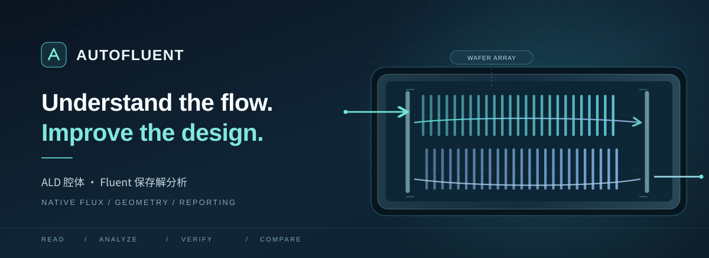

<div align="center">



<br />

### Turn simulation data into traceable engineering evidence.

**读取 Fluent 保存解，识别晶圆与挡板，核验原生通量，形成可分享的分析报告。**

<p>
  <a href="AutoFluent_V2.10.5_Windows_x64.zip"><strong>Download for Windows</strong></a>
  &nbsp; · &nbsp;
  <a href="docs/GETTING_STARTED.md"><strong>快速开始</strong></a>
  &nbsp; · &nbsp;
  <a href="source/"><strong>Source code</strong></a>
</p>

<sub>V2.10.5 · Windows x64 · ANSYS Fluent H5 · Go + Python · Stage release</sub>

</div>

---

## One workflow. Defensible results.

AutoFluent 是面向 **ALD 反应腔 CFD 分析**的 Windows 原生辅助工具。它从已有的 Fluent `.cas.h5` / `.dat.h5` 保存解出发，尽量把分散的文件配对、几何识别、`SV_FLUX` 原生通量统计、守恒检查、模型对比和报告导出组织在一条工作流中。

**离线分析不需要启动 Workbench，也不重新求解。** 如果晶圆或挡板几何存在歧义，已校验的端口流量和压降应当保留；不能确认的片间通道、孔数和 CV 不应被猜测填充。

```text
SELECT             IDENTIFY             MEASURE            VERIFY             REPORT
选择 Case/Data  →   核对几何和分区    →   积分原生 SV_FLUX  →   守恒与可信度检查  →   独立 HTML 报告
```

## What it does

| | 功能 | 核心价值 |
|:--:|---|---|
| **01** | **Read saved solutions** · 保存解读取 | Case/Data 配对、H5 元数据预检、原生通量来源追溯，支持对部分指标独立出数 |
| **02** | **Identify flow regions** · 几何识别 | 按晶圆壁面片、厚度、阵列与排归属识别片间通道；支持普通双排与交错双排的配置辅助分析 |
| **03** | **Quantify & verify** · 物理核验 | 端口正反向/净流量、质量守恒、可用压降，以及通过几何校验后的片间与挡板统计 |
| **04** | **Compare & explain** · 对比报告 | 区分同口径指标与不可直接比较的结果，导出自包含 HTML，并保留详细数据 |
| **05** | **Control when authorized** · 在线操作 | 可选择连接已有 Workbench/Fluent；设置发布与求解为独立、受用户确认约束的工作流 |

### Two workflows, one application

| **Offline analysis** · 推荐默认流程 | **Connected control** · 按需连接 |
|---|---|
| 读取已保存的 `.cas.h5` 和 `.dat.h5`，不需要 Workbench 端口。 | 连接**已打开的** Workbench 工程与 Fluent 容器。 |
| 对几何、通量、守恒和报告进行分阶段核验；不能确认时显示失败原因。 | 在明确授权和状态检查后进行工况预览/发布、任务监测与求解控制。 |
| **不初始化、不迭代、不改动原始保存解。** | **不自动新建工程、不擅自启动迭代。** |

## Get started

<details open>
<summary><strong>Five steps to your first flow review</strong></summary>

1. 下载 [**Windows x64 完整 ZIP**](AutoFluent_V2.10.5_Windows_x64.zip) 并全部解压。
2. 运行解压目录中的 `AutoFluent.exe`，保留 `worker/` 等随附文件。
3. 打开「**保存解分析**」，选择 `.cas.h5` 或 `.dat.h5`，确认实际匹配的 Case/Data 文件。
4. 查看几何预检与模块状态；识别有歧义时，在相同离线入口提供模型配置再尝试计算。
5. 查看端口、片间、挡板和压力的**实际可用结果**，导出 HTML；需要比较时核对共同截面与分区口径。

</details>

[**完整使用指南 →**](docs/GETTING_STARTED.md)

## Why the numbers can be trusted — or withheld

- **Native values first.** 质量流量优先使用保存解中的原生 `SV_FLUX`，不以速度插值冒充守恒面通量。
- **Geometry before channels.** 先识别晶圆实体，再分排、生成同排通道；几何不能确认时不假设通道数。
- **One face, one partition.** 截面网格面只能归属一个主分区；中央/外围/端部流量不重复加总。
- **Partial success is meaningful.** 晶圆配对失败不应抹去已通过的端口、守恒和压降结果。
- **Comparable means comparable.** 不同模型必须核对截面、方向、分界、通道对应及工况，不能直接用不同口径百分比判优。

## Download & resources

| 资源 | 链接 |
|---|---|
| **Windows 完整发布包** | [AutoFluent V2.10.5 ZIP](AutoFluent_V2.10.5_Windows_x64.zip) |
| **解压后的 Windows EXE** | [AutoFluent.exe](app/AutoFluent.exe) |
| **Go + Python 源码** | [Browse source](source/) |
| **快速入门** | [Getting started](docs/GETTING_STARTED.md) |
| **原版测试与变更记录** | [Source docs / QA](source/docs/) |
| **完整性清单** | [SHA256SUMS](source/SHA256SUMS.txt) |

<details>
<summary><strong>Architecture · 技术架构</strong></summary>

```text
AutoFluent.exe                Go · Native Windows UI
       │
       ├── Offline Analyzer   Python · Fluent HDF5 Case/Data
       │       │
       │       ├── Geometry / native face flux
       │       ├── Port / wafer / baffle / pressure checks
       │       ├── Structured JSON and CSV
       │       └── Self-contained HTML report
       │
       └── Connected Worker   Optional existing Workbench / Fluent
               │
               └── User-reviewed settings & solver tasks
```

</details>

<details>
<summary><strong>Scope & validation · 适用范围及验收状态</strong></summary>

当前公开包为 **V2.10.5 阶段修复版**。发布包记录的 Python **233/233** 项测试、Go 测试和 Windows x64 构建通过，主要是合成数据与历史回归。

**尚未完成现场验收**：6 寸 2.0 FFF（26,011,622 面）的完整晶圆与挡板识别、384 片/380 通道/210 孔的逐项核对、Windows 32 GB 内存峰值及全部原生界面交互。测试通过不代表真实模型已完整算通。

</details>

---

<div align="center">

<sub>Illustration is an original schematic, not a Fluent screenshot. No model outputs are fabricated for presentation.</sub>

<br />

<sub>本仓库暂未附开源许可证。完整源码可阅读，但不代表已授予第三方复用或再分发许可。相关开发工具：<a href="https://github.com/1463503175-pixel/AutoMesh">AutoMesh</a>。</sub>

</div>
