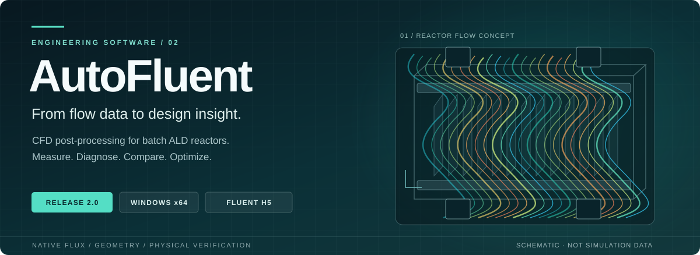
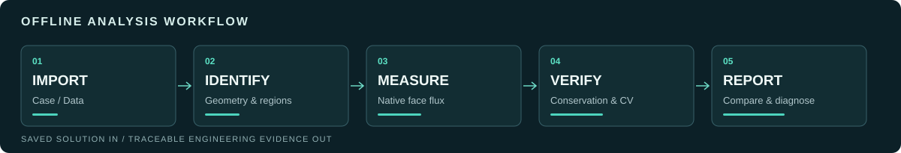

 

<a href="https://github.com/1463503175-pixel/AutoFluent/releases/download/2.0/AutoFluent.exe"><strong>下载 Windows 集成版 ↓</strong></a>
&nbsp; · &nbsp;
<a href="docs/GETTING_STARTED.md">快速开始</a>
&nbsp; · &nbsp;
<a href="worker/">分析源码</a>
&nbsp; · &nbsp;
<a href="https://github.com/1463503175-pixel/AutoFluent/releases/tag/2.0">版本发布</a>

Release 2.0 &nbsp; / &nbsp; 2026.11.22 &nbsp; / &nbsp; Windows x64 &nbsp; / &nbsp; ANSYS Fluent HDF5

---

## 让仿真结果直接服务于结构优化

**AutoFluent 是面向批量式原子层沉积（ALD）反应腔的 Fluent 后处理与仿真辅助工作站。**

从 Fluent 保存解中读取原生面质量通量、网格拓扑及求解场，自动组织晶圆片间、旁路、挡板、压力和物种数据。将重复的统计操作转化为可定位、可核验、可对比的工程分析。

无需启动 Fluent 即可完成保存解的离线分析；需要统一工况或继续求解时，再连接已有 Workbench / Fluent 会话。

## 01 / 核心能力

<table>
<tr>
<td width="50%" valign="top">
<h3>Native H5 · 原生数据</h3>

自动配对 Case/Data，检查结果组、原生通量及面 ID，直接读取质量流量和求解场，而不是从云图估算。

<b>输入</b>：.cas.h5 / .dat.h5
</td>
<td width="50%" valign="top">
<h3>Wafer mapping · 晶圆通道</h3>

识别晶圆层、排及片间隙，支持几何配置辅助的普通和交错排；统计逐通道净流量、CV、中央与外围旁路。

<b>输出</b>：流量去向与异常通道位置
</td>
</tr>
<tr>
<td valign="top">
<h3>Flow diagnostics · 流场诊断</h3>

分析上下挡板、逐孔流量、出口空间关系及可用压力数据，区分局部偏流与整体均匀性问题。

<b>输出</b>：挡板分布、压力与异常定位
</td>
<td valign="top">
<h3>Species &amp; surface · 物种与反应</h3>

在保存解字段可用时，统计物种浓度、暴露相关数据及表面位点覆盖率。

<b>边界</b>：单个快照不代表完整曝光剂量或成膜饱和
</td>
</tr>
<tr>
<td valign="top">
<h3>Physical checks · 物理核验</h3>

区分分区闭合、整体及局部质量守恒、几何归属与可比性；保留独立成功的指标。

<b>原则</b>：缺失的数据不以零代替
</td>
<td valign="top">
<h3>Report V11 · 分析报告</h3>

生成结构化结果与 HTML 报告，把关键指标、空间分布、数据可信度和方案对照集中组织。

<b>入口</b>：<a href="templates/report_v11/">V11 报告模板</a>
</td>
</tr>
</table>

## 02 / 从保存解到工程证据

流程示意；封面流线为概念插图，不是实际求解结果。

| 研究问题 | AutoFluent 提供的依据 |
|---|---|
| 气体有多少真正经过晶圆？ | 各层片间净流量、占入口比例及旁路分布 |
| 哪一处流量最弱？ | 分排、逐通道坐标、极值与均匀性 CV |
| 挡板是否存在偏流？ | 逐孔及孔排流量、边缘通路、压力与出口对应 |
| 新结构是否改善了流场？ | 同口径指标、模型对比及守恒核验 |
| 物种是否充分到达反应区？ | 可取得的浓度、暴露相关量和表面位点覆盖率；完整反应仍需独立验证 |

## 03 / 快速上手

**下载 → 运行 → 分析**，日常保存解分析不需要连接 Workbench。

1. 下载 [**AutoFluent.exe**](https://github.com/1463503175-pixel/AutoFluent/releases/download/2.0/AutoFluent.exe)，放到本地可写目录，双击运行。
2. 在保存解分析入口选择任意一份 Fluent H5 文件，核对 Case/Data 配对及几何预检。
3. 执行分析，查看 HTML 报告与数据核验结果。需要模型比较时，先核对工况和统计截面。

[完整使用指南 →](docs/GETTING_STARTED.md) &nbsp; · &nbsp; [几何配置示例 →](templates/geometry_config_example_staggered.json)

### 两种工作方式

| 离线分析 · Offline | 在线控制 · Connected |
|:---|:---|
| 使用已保存的 Case/Data，直接统计流量、压力、物种和几何分区。 | 连接已有 Workbench / Fluent，进行受控的标准工况及求解任务。 |
| 无需启动 Fluent，不改变原始保存解。 | 工况发布或迭代须经用户确认。 |

## 04 / 项目与资源

| 模块 | 入口 |
|---|---|
| Desktop application | [最新集成程序](app/) |
| Analysis engine | [Python 分析源码](worker/) |
| Configuration &amp; report | [配置及报告模板](templates/) |
| Documentation | [使用说明](docs/GETTING_STARTED.md) |
| Release verification | [SHA-256](SHA256SUMS.txt) · [源码恢复清单](docs/release_inventory.json) |

<b>发布来源与技术边界 / Release provenance</b>

当前发布为 Release 2.0（2026-11-22）。仓库中的 EXE、50 个 Python 模块、3 份模板及 3 份图标资源均来自此次上传的一体化程序；展示图和使用说明单独维护。

集成程序未包含完整可恢复的 Go 桌面源码及构建定义，因此当前仓库不保证可重建完全一致的 EXE。静态拆包核验不代表 Windows、Fluent 联机或特定真实模型的功能验收。

流量分布与 CV 用于评价流场，而非直接证明膜厚均匀性；不同几何的统计口径及收敛状态需分别核验。

---

<b>AutoFluent</b> &nbsp; / &nbsp; Engineering insight from native flow data.

[下载最新版本](https://github.com/1463503175-pixel/AutoFluent/releases/tag/2.0) &nbsp; · &nbsp; [提交问题](https://github.com/1463503175-pixel/AutoFluent/issues)

